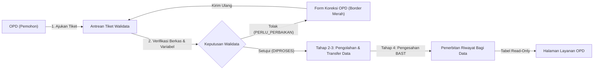
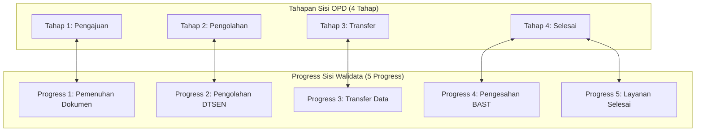

# DOKUMENTASI SISTEM WALIDATA DAN INTEGRASI HALAMAN OPD
## Standar Penulisan Teknis ASD-STE100 (Simplified Technical English)

---

## 1. DESKRIPSI SISTEM (SYSTEM OVERVIEW)

Sistem ini mengelola layanan bagi pakai data mikro DTSEN (Data Terpadu Sosial Ekonomi Nasional / Regsosek).
Sistem menghubungkan dua entitas utama:
1. **Walidata** (Dinas Komunikasi, Informatika, Statistik, dan Persandian / DKISP).
2. **OPD** (Perangkat Daerah pemohon data).

Dasar hukum operasional sistem menggunakan SOP Resmi:
**Nomor SOP: 555/07-SOP/DISKOMINFO SP/2026**.

---

## 2. ARSITEKTUR PERAN DAN AKSES SISTEM

Sistem memisahkan akses URL dan peran pengguna secara ketat.

| Atribut Sistem | Sisi Walidata | Sisi OPD |
| :--- | :--- | :--- |
| **Peran Akun (`role`)** | `superadmin` / `admin` | `perangkat_daerah` |
| **URL Login** | `/dkisp-secret` (URL Rahasia) | `/login` atau `/opd/login` |
| **Middleware Pelindung** | `admin`, `auth`, `session.timeout` | `opd`, `auth`, `session.timeout` |
| **Root Redirect** | `/admin/dashboard` | `/opd/dashboard` |
| **Fungsi Utama** | Verifikasi, olah data, terbitkan riwayat, kelola user | Buat permohonan, perbaiki berkas, unduh data resmi |

> [!NOTE]
> Sistem memiliki proteksi URL ganda. Jika OPD mencoba membuka URL `/admin/*`, middleware `admin` otomatis menolak akses dan mengembalikan pengguna ke dashboard OPD.

---

## 3. MATRIKS KONEKSI HALAMAN (WALIDATA <-> OPD)

Tabel berikut menunjukkan koneksi langsung antara halaman Walidata dan halaman OPD.

| No | Modul Sistem | Halaman Walidata | Halaman OPD | Data Terhubung |
| :---: | :--- | :--- | :--- | :--- |
| **1** | **Autentikasi & Reset Sandi** | `/admin/users` | `/login` & `/opd/user` | Model `PasswordResetRequest`, Model `User` |
| **2** | **Pengajuan Permohonan** | `/admin/dashboard` | `/opd/tiket/create` | Model `TiketDtsen` (Status: `PENDING`) |
| **3** | **Verifikasi Berkas & Variabel** | `/admin/tiket/{id}` | `/opd/tiket/{id}` | Flag `step1_done`, `step2_done`, `variabel_disetujui` |
| **4** | **Revisi Berkas Ditolak** | `/admin/tiket/{id}` (Aksi Koreksi) | `/opd/tiket/{id}/edit` | `status = PERLU_PERBAIKAN`, `catatan_admin`, `revisi_items` |
| **5** | **SOP Pemenuhan Layanan** | `/admin/bagi-pakai-dtsen` | `/opd/tiket/{id}/formulir` | Dokumen SOP Formulir Lampiran I (Blade & DOCX) |
| **6** | **Penerbitan Riwayat Data** | `/admin/riwayat-bagi-data` | `/opd/layanan-bagi-pakai` | Model `RiwayatBagiDataDtsen` |
| **7** | **Audit & Laptop Tracking** | `/admin/logs` | Seluruh Halaman OPD | Model `AuditLog` (IP, Cookie Device, User Agent) |

---

## 4. REALISASI ALUR KERJA TERINTEGRASI

### 4.1. Alur Pengajuan Tiket Permohonan Baru
1. OPD masuk ke `/opd/dashboard`.
2. OPD klik tombol **Ajukan Permohonan Baru** (`/opd/tiket/create`).
3. OPD mengisi identitas kegiatan dan memilih variabel data DTSEN (maksimal 131 variabel).
4. OPD mengunggah dokumen syarat (Surat Permohonan, KAK, Surat Pernyataan / ROPA / DPIA).
5. Sistem menyimpan data ke tabel `tiket_dtsen` dengan status awal `PENDING`.
6. Sistem membatasi hak edit. OPD tidak dapat mengubah formulir selama status masih `PENDING`.
7. Walidata menerima notifikasi tiket baru pada `/admin/dashboard`.

### 4.2. Alur Verifikasi dan Siklus Perbaikan (Reject & Revision Loop)
1. Walidata membuka detail tiket pada `/admin/tiket/{id}`.
2. Walidata memeriksa berkas fisik dan daftar variabel.
3. Jika berkas salah:
   - Walidata memilih status **Perlu Perbaikan Permohonan**.
   - Walidata menulis catatan perbaikan pada kolom catatan.
   - Walidata mencentang dokumen yang salah (contoh: Surat Permohonan, KAK).
4. Sistem memperbarui data:
   - Nilai `status` berubah menjadi `PERLU_PERBAIKAN`.
   - Nilai `revisi_items` menyimpan daftar elemen yang salah.
5. Sisi OPD:
   - Halaman `/opd/tiket/{id}` menampilkan kotak peringatan merah **Catatan Koreksi Walidata**.
   - Tombol **Perbaiki Permohonan** menjadi aktif.
   - Tombol mengarahkan OPD ke `/opd/tiket/{id}/edit`.
6. Tampilan Halaman Edit OPD (`/opd/tiket/{id}/edit`):
   - Elemen yang ditandai salah otomatis mendapat garis tepi merah tebal (`border: 2px solid #dc2626`).
   - Kotak berkas memiliki tombol hapus berkas lama dan unggah berkas pengganti.
   - Teks instruksi hanya menampilkan catatan murni dari Walidata.
7. OPD klik tombol **Kirim Ulang Permohonan ke Walidata**:
   - Status tiket berubah kembali menjadi `PENDING`.
   - Form permohonan terkunci kembali (read-only).
   - Tiket masuk kembali ke antrean verifikasi Walidata.

### 4.3. Alur Pemenuhan Dokumen SOP Resmi (SOP: 555/07-SOP/DISKOMINFO SP/2026)
1. Walidata mengelola pemenuhan layanan pada `/admin/bagi-pakai-dtsen`.
2. Walidata memasukkan nomor naskah, nomor agenda disposisi, tanggal penerimaan, dan nama verifikator.
3. Sistem membuat lembar kerja resmi:
   - Tampilan web: `/admin/bagi-pakai-dtsen/{id}/formulir`.
   - Unduh dokumen: `/admin/bagi-pakai-dtsen/{id}/download-docx`.
4. OPD dapat melihat dan mengunduh formulir resmi tersebut melalui `/opd/tiket/{id}/formulir`.

### 4.4. Alur Penerbitan Riwayat Bagi Data Resmi
1. Setelah tahap 4 (BAST) selesai, Walidata membuka menu **Riwayat Bagi Data** (`/admin/riwayat-bagi-data`).
2. Walidata membuat catatan penerbitan paket data resmi untuk instansi OPD penerima.
3. Sisi OPD:
   - OPD membuka menu **Layanan Bagi Pakai Data** (`/opd/layanan-bagi-pakai`).
   - Tabel menampilkan daftar data yang resmi diterima oleh instansi OPD tersebut.
   - OPD klik tombol **Detail** untuk melihat metadata paket data (`/opd/riwayat-bagi-data/{id}`).
   - Tabel bersifat read-only untuk melindungi integritas data.

### 4.5. Alur Penguncian Login dan Reset Kata Sandi
1. Akun OPD mencoba masuk pada `/login`.
2. Jika OPD salah memasukkan kata sandi 3 kali berturut-turut:
   - Sistem menampilkan pesan peringatan.
   - Sistem menampilkan tombol **Minta Reset Kata Sandi ke Walidata**.
3. OPD menekan tombol tersebut:
   - Sistem membuat permintaan reset pada tabel `password_reset_requests` dengan status `MENUNGGU`.
4. Sisi Walidata:
   - Menu **User Management** pada sidebar menampilkan lencana angka berwarna kuning.
   - Halaman `/admin/users` menampilkan kotak notifikasi permintaan reset.
5. Walidata memproses reset:
   - Walidata dapat menyetujui permintaan dengan satu klik.
   - Walidata juga dapat mereset kata sandi akun langsung dari tabel pengguna.
6. Kata sandi akun tersimpan dalam dua bentuk:
   - Kolom `password`: Hash bcrypt aman untuk otentikasi login.
   - Kolom `password_display`: Teks terenkripsi AES-256 (`Crypt::encryptString`).
7. Walidata dapat melihat kata sandi asli akun melalui tombol ikon mata (`👁`).
8. Setelah kata sandi direset, OPD login dan dapat mengganti kata sandi secara mandiri pada `/opd/user`.

### 4.6. Alur Audit Trail dan Pelacakan Laptop OPD
1. Browser OPD menyimpan ID perangkat unik pada `localStorage` (contoh: `WIN-OPD-7821`).
2. Script mengirimkan ID perangkat tersebut melalui cookie `app_device_id`.
3. Setiap mutasi data dan sesi login dicatat oleh `AuditLogger`:
   - Nama aksi (contoh: `AUTH_LOGIN`, `TIKET_CREATE`, `TIKET_REVISI_SUBMITTED`).
   - Alamat IP pengguna.
   - ID Laptop / Perangkat.
   - Informasi Browser / User Agent.
4. Walidata memantau jejak digital tersebut pada `/admin/logs` dan `/admin/users/{id}`.

---

## 5. TABEL PEMETAAN DATABASE DAN STATUS PROSES

### 5.1. Status Permohonan Tiket (`tiket_dtsen.status`)

| Nilai Status | Arti Status | Hak Akses OPD | Tampilan Walidata |
| :--- | :--- | :--- | :--- |
| `PENDING` | Permohonan baru dikirim | Hanya Lihat (Read-only) | Perlu Verifikasi Berkas |
| `PERLU_PERBAIKAN` | Berkas ditolak oleh Walidata | **Bisa Edit & Unggah Ulang** | Menunggu Perbaikan OPD |
| `DIPROSES` | Berkas disetujui Walidata | Hanya Lihat (Read-only) | Tahap Pengolahan / Transfer |
| `SELESAI` | BAST disahkan dan selesai | Hanya Lihat & Unduh Data | Layanan Selesai |

### 5.2. Pemetaan 4 Tahap OPD vs 5 Progress Walidata

---

## 6. KESIMPULAN

Seluruh koneksi antara Walidata dan OPD telah aktif dan teruji:
1. **Otentikasi**: Pemisahan portal terjamin, proteksi salah 3x kata sandi terhubung langsung ke Walidata.
2. **Siklus Tiket**: Pengajuan, penguncian berkas, penolakan dengan catatan koreksi, penandaan border merah, dan kirim ulang berfungsi penuh.
3. **Dokumen SOP**: Integrasi Formulir Lampiran I SOP resmi `555/07-SOP/DISKOMINFO SP/2026` berjalan dua arah.
4. **Penerbitan Data**: Riwayat bagi data yang diterbitkan Walidata tampil otomatis dan aman di sisi OPD.
5. **Keamanan**: Pelacakan jejak laptop dan audit sistem berjalan secara otomatis.

